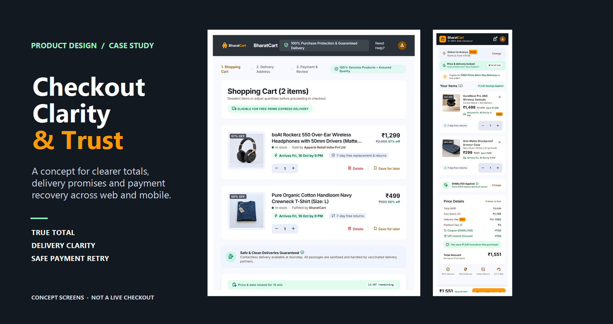

# Checkout Clarity & Trust

### A checkout case study on making the final purchase feel clearer, more predictable, and easier to recover.

**Product strategy · Checkout UX · Web & mobile concepts**

 

 

<em>Independent concept screens · Select the cover to open the web cart prototype</em>

> **Independent portfolio concept:** The PRD uses Amazon as its product context. The prototype screens use **BharatCart**, a fictional concept brand. This work is not affiliated with or endorsed by Amazon. No Amazon internal data or measured business results are represented here.

## The opportunity

People with purchase intent may leave checkout when they cannot confidently answer three questions:

| Shopper question | Opportunity explored |
| --- | --- |
| **What will I actually pay?** | **P0 · True Total** — show an estimated total and applicable charges, taxes, and discounts before payment. |
| **When will it arrive, and what if plans change?** | **P1 · Delivery Clarity** — surface delivery and return information early; explain material changes before order placement. |
| **What happens if my payment fails?** | **P2 · Safe Recovery** — preserve the cart and offer an actionable retry or alternate method without duplicate orders or charges. |

These are hypotheses from a draft PRD—not validated causes of abandonment. Research and product analytics should establish which frictions matter before treating the proposed concepts as solutions.

## Explore the concepts

Static HTML prototypes open directly in a modern browser. PNG previews are provided for quick viewing.

| Journey moment | Web concept | Mobile concept |
| --- | --- | --- |
| **Shopping cart** | [Open prototype](<Prototype Screens/Web Screens/shopping_cart_bharatcart/code.html>) · [View preview](<Prototype Screens/Web Screens/shopping_cart_bharatcart/screen.png>) | [Open prototype](<Prototype Screens/Mobile Screens/cart_bharatcart_mobile/code.html>) · [View preview](<Prototype Screens/Mobile Screens/cart_bharatcart_mobile/screen.png>) |
| **Payment selection** | [Open prototype](<Prototype Screens/Web Screens/checkout_payment_bharatcart/code.html>) · [View preview](<Prototype Screens/Web Screens/checkout_payment_bharatcart/screen.png>) | [Open prototype](<Prototype Screens/Mobile Screens/payment_selection_bharatcart_mobile/code.html>) · [View preview](<Prototype Screens/Mobile Screens/payment_selection_bharatcart_mobile/screen.png>) |
| **Payment failure & recovery** | [Open prototype](<Prototype Screens/Web Screens/payment_failed_retry_safe_bharatcart/code.html>) · [View preview](<Prototype Screens/Web Screens/payment_failed_retry_safe_bharatcart/screen.png>) | [Open prototype](<Prototype Screens/Mobile Screens/payment_failed_retry_safe_bharatcart_mobile/code.html>) · [View preview](<Prototype Screens/Mobile Screens/payment_failed_retry_safe_bharatcart_mobile/screen.png>) |
| **Order confirmation** | [Open prototype](<Prototype Screens/Web Screens/order_confirmed_bharatcart/code.html>) · [View preview](<Prototype Screens/Web Screens/order_confirmed_bharatcart/screen.png>) | [Open prototype](<Prototype Screens/Mobile Screens/order_confirmed_bharatcart_mobile/code.html>) · [View preview](<Prototype Screens/Mobile Screens/order_confirmed_bharatcart_mobile/screen.png>) |

Each HTML screen is a **visual prototype**, not a functioning shopping or payment flow. Fonts, styling, and some screen imagery load from external sources; an internet connection may be needed for the intended appearance.

## Product thinking

### Goals

- Help more eligible carts turn into completed purchases.
- Make applicable costs, delivery expectations, and return information easier to understand before purchase.
- Let shoppers recover from a supported payment failure without rebuilding the cart.

### Measurement approach

- **North-star candidate:** Cart-to-purchase conversion rate.
- **Supporting measures:** Completed orders and orders per customer.
- **Guardrails:** Cart abandonment, checkout error rate, and D30 inactivity.

Define eligible carts, the conversion event, attribution window, and baseline before evaluating a change. Use an experiment or another suitable evaluation method; changes in revenue alone do not establish that a feature caused an outcome.

## Case-study files

| Document | What it contains |
| --- | --- |
| [Product requirements](PRD.md) | Problem framing, working personas, opportunities, requirements, metrics, risks, and open questions. |
| [Project context](context.md) | Product scope, assumptions, dependencies, and constraints. |
| [Delivery plan](plan.md) | Proposed validation, design, testing, delivery, and portfolio steps. |
| [Web design system](<Prototype Screens/Web Screens/bharat_checkout_trust_system/DESIGN.md>) | Web visual direction, tokens, layout, and component guidance. |
| [Mobile design system](<Prototype Screens/Mobile Screens/bharat_checkout_trust_system/DESIGN.md>) | Mobile visual direction, tokens, layout, and component guidance. |
| [Original PRD PDF](Checkout-Clarity-Trust-PRD.pdf) | PDF version of the supplied product requirements document. |

## Evidence & prototype limitations

- The PRD is marked **Draft**. The personas, root causes, priorities, and proposed impact are not validated research findings.
- Prototype prices, fees, discounts, delivery dates, timers, support details, and security/compliance statements are illustrative—not real offers, verified guarantees, or implemented safeguards.
- The screens do not implement pricing logic, delivery estimation, authentication, address storage, payment processing, order persistence, or duplicate-transaction protection.
- The repository includes exploratory persona, empathy, journey, and roadmap visuals (including assets in `GPT Images/`). Treat these as draft artifacts: their assertions have not been verified, and the roadmap visual does not match the priority order in the PRD. The PRD is the current source of truth.
- No conversion lift, customer research result, or production readiness is claimed.

## About this portfolio project

This project is intended to demonstrate hypothesis-led product framing, prioritization, checkout experience design, and measurable requirements. BharatCart is a presentation brand for the concept, not a real service.
